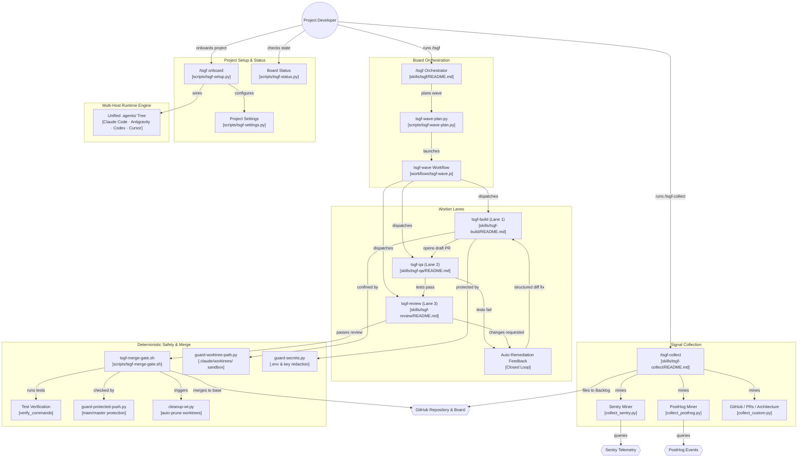

<div align="center">

# ⚡ TSGF (Task & Software Generation Framework)

<p><strong>Add tasks, walk away, get merged PRs with proof.</strong></p>

<p>Autonomous AI Software Factory for <strong>Google Antigravity (Primary)</strong>, Claude Code, and Agent Runtimes.</p>

<p>


</p>

<p><a href="#install">Install</a> · <a href="#quick-start">Quick Start</a> · <a href="#architecture">Architecture</a> · <a href="website/index.html"><strong>🌐 Live Web Dashboard</strong></a> · <a href="diagrams/skill-map/index.html">Interactive Skill Map ↗</a> · <a href="diagrams/index.html">Kanban Sim</a> · <a href="#skills">Skills</a> · <a href="#guard-hooks">Guards</a> · <a href="docs/hosts.md">Hosts</a></p>

</div>

---

## What is TSGF?

**TSGF** turns your GitHub Project board into an autonomous software development factory:
1. **You drag a task card to `Ready`** (or let `/tsgf-collect` file bug reports and feature gaps).
2. **TSGF Orchestrator plans execution waves**, claims tasks, and spins up isolated worker lanes.
3. **`tsgf-build` creates a dedicated git worktree**, writes the minimal safe diff, runs unit tests, and creates a draft PR.
4. **`tsgf-qa` validates acceptance criteria**, runs automated end-to-end tests, captures screenshot evidence, and bounces the task back to `Building` if bugs are discovered.
5. **`tsgf-review` conducts adversarial review**, checks regression memory, and verifies project merge policies.
6. **The automated merge gate validates CI & test suites**, merges the PR, and cleans up the worktree.

---

## Quick Start

### 1. Installation

In your target project directory:

```bash
curl -fsSL https://raw.githubusercontent.com/gnanesh-16/TSGF/main/get.sh | bash
```

Or clone and install locally:

```bash
git clone https://github.com/gnanesh-16/TSGF.git
./TSGF/install.sh /path/to/your-project
```

### 2. Onboard Your Project

In your project repository with Claude Code / Antigravity agent:

```bash
/tsgf onboard
```

The interactive 8-step wizard configures:
- 🔍 Environment & tool check (`git`, `gh`, `python3`, `node`)
- 🐙 GitHub Project & repository linkage
- 📋 Kanban column verification (`Backlog` · `Ready` · `Building` · `QA` · `Review` · `Done` · `Blocked`)
- 🛡️ Guard hooks installation into `.claude/settings.json`
- ⚙️ Test & verification commands configuration

### 3. Run the Factory

```bash
/tsgf run my-app
```

Add cards to `Ready`, and watch the board drain itself into merged, verified PRs!

---

## Skills

TSGF ships **8 skills (5 you invoke, 3 the board runs)**:

### You Type (Interactive Commands)

| Skill | Description | Command |
|---|---|---|
| [`/tsgf`](skills/tsgf/README.md) | Master orchestrator: plans waves, oversees lane dispatch, checks status, merges. | `/tsgf run [slug]` |
| [`/tsgf-collect`](skills/tsgf-collect/README.md) | Problem detector: scans Sentry, PostHog, GitHub issues, and PR patterns to file cards. | `/tsgf-collect sentry` |
| [`/ui-refine-loop`](skills/ui-refine-loop/README.md) | Dedicated critique → refine feedback loop to polish a frontend route or component. | `/ui-refine-loop /dashboard` |
| [`/visual`](skills/visual/README.md) | Generates interactive single-page visual recaps, architecture diagrams, and plan graphs. | `/visual recap` |
| [`/tsgf-sync`](skills/tsgf-sync/README.md) | Safe git synchronization: atomic commits per logical change, merge-pull, and safe push. | `/tsgf-sync` |

### The Board Runs (Autonomous Lanes)

| Lane | Skill | Responsibility |
|---|---|---|
| **Building** | [`tsgf-build`](skills/tsgf-build/README.md) | Isolated worktree, smallest safe diff, test suite runs, draft PR creation. |
| **QA** | [`tsgf-qa`](skills/tsgf-qa/README.md) | Verifies Acceptance Criteria, browser screenshots, runtime proof, test-gap detection. |
| **Review** | [`tsgf-review`](skills/tsgf-review/README.md) | Adversarial code review, checks against historical review findings, enforces merge gate. |

---

## Guard Hooks & Safety

All worker actions are guarded by deterministic Python hooks (`hooks/`) configured in `.claude/settings.json`:

| Hook | Purpose |
|---|---|
| [`guard-worktree-path.py`](hooks/guard-worktree-path.py) | Confines `git worktree add` strictly to `.claude/worktrees/`. |
| [`guard-secrets.py`](hooks/guard-secrets.py) | Prevents workers from reading, piping, or dumping `.env`, SSH keys, and secret credentials. |
| [`guard-key-literals.py`](hooks/guard-key-literals.py) | Blocks commits containing live high-entropy API keys or secret tokens. |
| [`guard-delete-outside.py`](hooks/guard-delete-outside.py) | Halts destructive `rm`, `find -delete`, or `git clean` targeting outside the workspace or root (`/`, `~`). |
| [`guard-protected-push.py`](hooks/guard-protected-push.py) | Rejects direct or force pushes to protected branches (`main`, `master`, base). |
| [`cleanup-wt.py`](hooks/cleanup-wt.py) | Safely removes merged worktrees and branches, logging recovery records. |
| [`tsgf-merge-gate.sh`](scripts/tsgf-merge-gate.sh) | Verifies test suites, clean base commits, and database migration safety before merge. |

---

## Architecture

> 🗺️ **Interactive Architecture Map**: Explore the interactive zoomable/pannable canvas at [`diagrams/skill-map/index.html`](diagrams/skill-map/index.html) or launch the [Live Simulator](diagrams/index.html).

### End-to-End Autonomous Software Factory Flow



### The 7-Column Kanban Board

```
[Backlog] ──► [Ready] ──► [Building] ──► [QA] ──► [Review] ──► [Done]
                            ▲             │         │
                            │             ▼         ▼
                            └───────── [Auto-Remediation Bounce] 
                                          │
                                    [Blocked] ◄── Needs Human Attention
```

- **Backlog**: Telemetry discoveries filed by `/tsgf-collect` or developers.
- **Ready**: High-priority tasks approved by human developer, ready for autonomous dispatch.
- **Building**: Worker executes task in an isolated branch worktree under `.claude/worktrees/` (`<400 lines`).
- **QA**: Runtime verification against Acceptance Criteria + screenshot evidence.
- **Review**: Adversarial review + historical regression memory check.
- **Done**: Verified squash-merge landing on base branch via `tsgf-merge-gate.sh`.
- **Blocked**: Parked cards requiring human action (auth, money, destructive DB changes, or scope splits).

### TSGF Exclusive Innovations

1. **Multi-Host Interoperability**: Seamlessly operates across **Google Antigravity**, **Claude Code**, **OpenAI Codex**, and **Cursor** using the unified `.agents/` single source of truth.
2. **Closed-Loop Auto-Remediation**: Failing QA tests or requested review changes bounce back to the Building lane with structured failure context, creating an autonomous self-healing loop.
3. **Visual Proof Engine**: Automated headless browser screenshot capture with Before/After visual comparison sheets in every pull request.
4. **Adversarial Review Memory Ledger**: Persistent store of past review findings at `.claude/tsgf/review-memory.json` preventing recurring architectural regressions.
5. **Token-Bucket Rate Guard**: Prevents GitHub API quota exhaustion during continuous autonomous runs via `tsgf-gh-guard.sh`.

---

## Model Ladders

TSGF supports multi-tier model routing based on task complexity:

| Tier | Router | Easy Card | Medium Card | Hard Card |
|---|---|---|---|---|
| **Default** | Haiku / Luna | Sonnet / Sol | Opus / Astra | Session Flagship |
| **`--low`** | Haiku / Luna | Haiku / Luna | Sonnet / Sol | Opus / Astra |
| **`--high`** | Sonnet / Sol | Opus / Astra | Opus / Astra | Opus / Astra |

---

## License

MIT © 2026 Gnanesh Balusa ([LICENSE](LICENSE)).
Built upon principles from [obra/superpowers](https://github.com/obra/superpowers) and [mattpocock/skills](https://github.com/mattpocock/skills).
